# Próximas publicações – Apadrinhe a Educação

Instagram @osoconsolador · todos os posts às 18h de Brasília · atualizado em 06/11/2026 21:36

## 15/10 (quinta) · Post único

**✅ Publicado** · [ver no Instagram](https://www.instagram.com/p/Deh6a3aGFZy/)

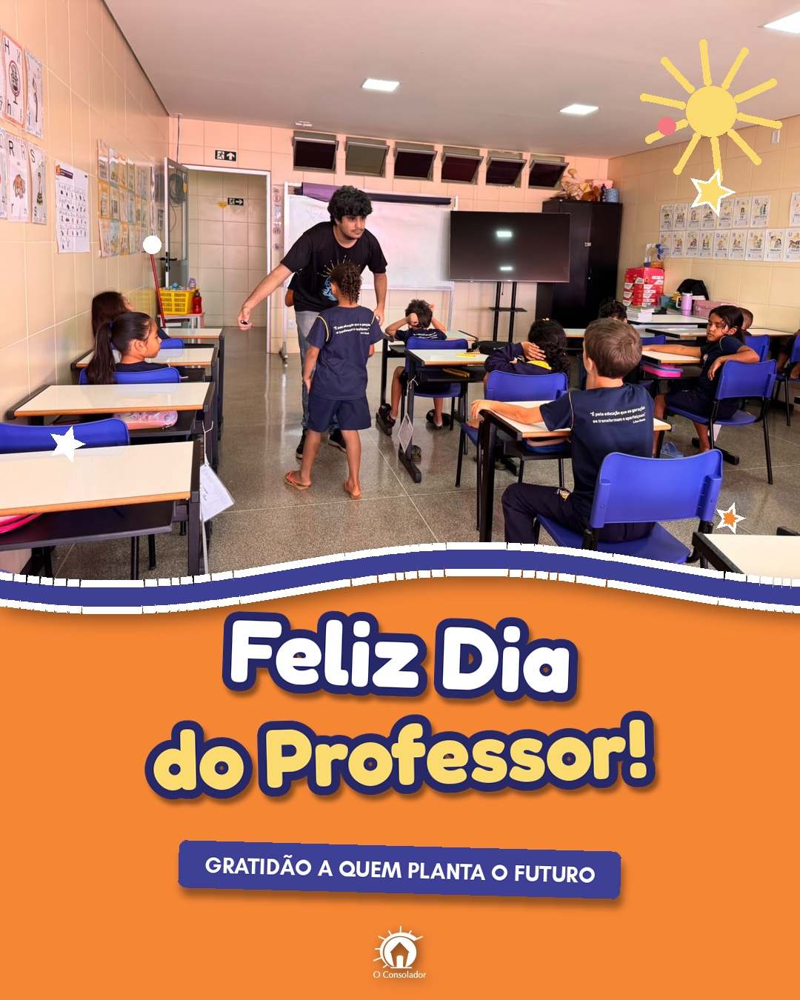

> Feliz Dia do Professor! 🍎  
> Gratidão a quem planta o futuro todos os dias, com paciência, carinho e dedicação, nas crianças da Escola Espírita Léon Denis.  
> Obrigada, professores e equipe, por fazerem a diferença. 💛  
> #DiaDoProfessor #OConsolador #EscolaLéonDenis  

---

## 16/10 (sexta) · Carrossel · 3 slides

**✅ Publicado** · [ver no Instagram](https://www.instagram.com/p/DekfB_5iU7z/)

 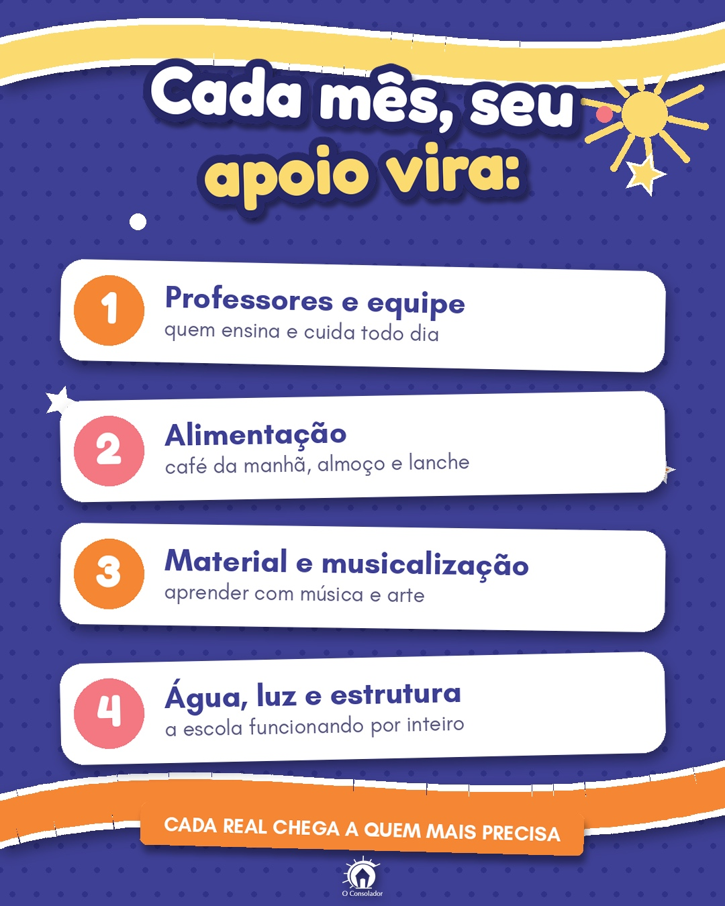 

> Você já se perguntou para onde vai o seu apoio? 💛  
> Cada mês, o apadrinhamento vira professores e equipe, alimentação (café da manhã, almoço e lanche), material, musicalização e a estrutura que mantém a escola funcionando.  
> Na Escola Espírita Léon Denis, cada real chega em quem mais precisa: as crianças do Sol Nascente.  
> 👉 Apadrinhe a partir de R$ 20/mês. Link na bio.  
> #ApadrinheAEducação #OConsolador #EscolaLéonDenis #SolNascente  

---

## 19/10 (segunda) · Carrossel · 2 slides

**✅ Publicado** · [ver no Instagram](https://www.instagram.com/p/DesNb0vAeqa/)

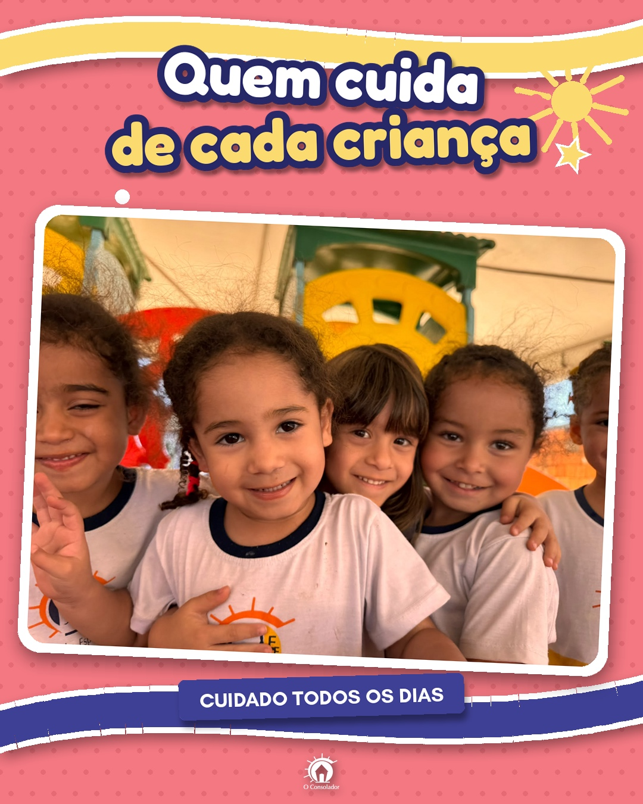 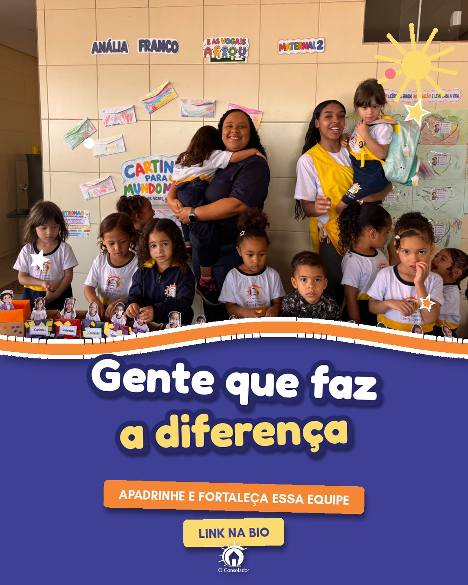

> Por trás de cada criança bem cuidada, tem uma equipe que chega todo dia com carinho. 💛  
> Professoras, monitoras e toda a equipe da Escola Espírita Léon Denis ensinam, acolhem e cuidam de quem mais precisa no Sol Nascente.  
> 👉 Apadrinhe e fortaleça essa equipe. Link na bio.  
> #ApadrinheAEducação #OConsolador #EscolaLéonDenis #EquipeQueTransforma  

---

## 21/10 (quarta) · Carrossel · 3 slides

**✅ Publicado** · [ver no Instagram](https://www.instagram.com/p/DexXJdIDEgp/)

 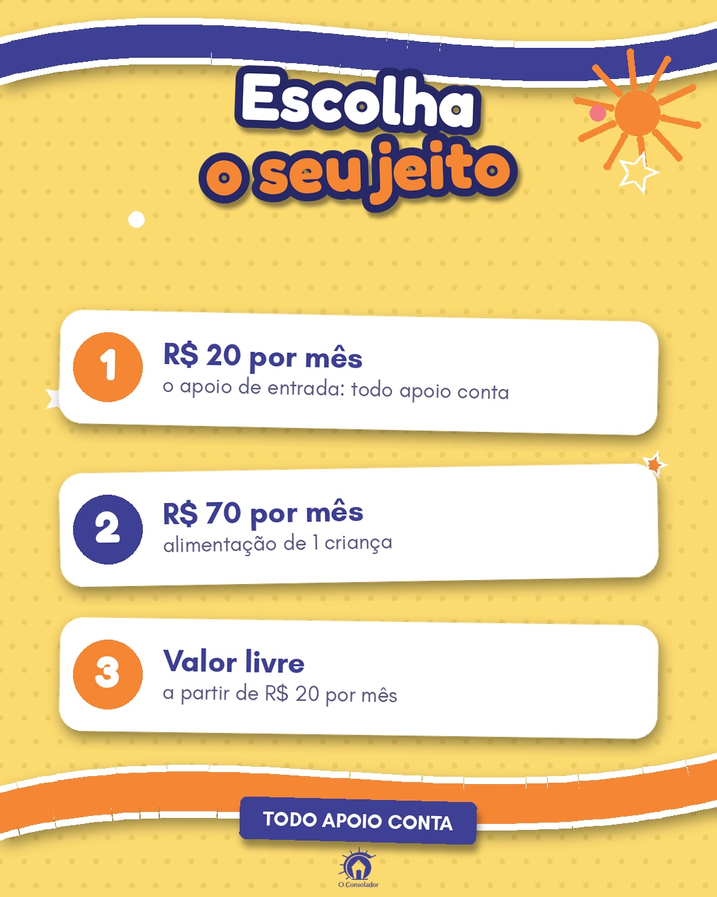 

> Apadrinhar é simples e cabe no seu bolso. 🙌  
> 1️⃣ R$ 20/mês: o apoio de entrada. Todo apoio conta.  
> 2️⃣ R$ 70/mês: a alimentação de 1 criança.  
> 3️⃣ Valor livre: a partir de R$ 20 por mês.  
> Escolha o seu e apadrinhe hoje mesmo. Link na bio. 💙  
> #ApadrinheAEducação #OConsolador #SolNascente  

---

## 23/10 (sexta) · Post único

**✅ Publicado** · [ver no Instagram](https://www.instagram.com/p/De2gqmCjPGV/)

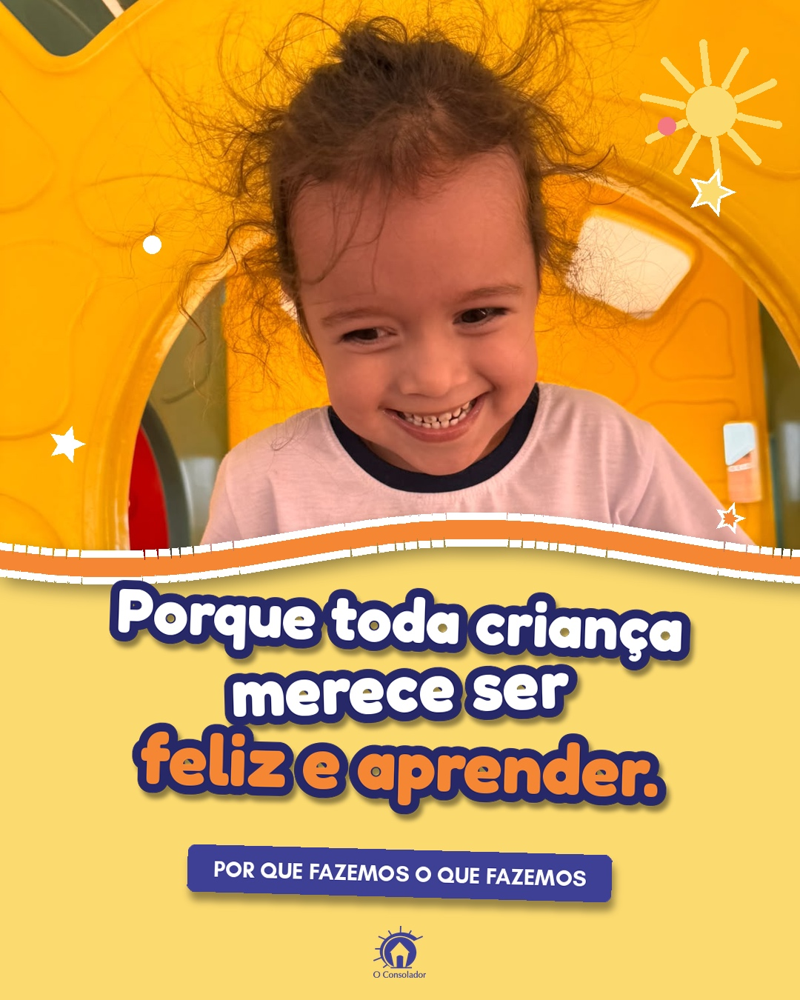

> Porque toda criança merece ser feliz e aprender. 🧡  
> É por esse sorriso que as Obras Sociais O Consolador trabalham todos os dias no Sol Nascente.  
> Quer fazer parte? Apadrinhe a partir de R$ 20/mês. Link na bio.  
> #ApadrinheAEducação #OConsolador #SolNascente  

---

## 26/10 (segunda) · Carrossel · 2 slides

**✅ Publicado** · [ver no Instagram](https://www.instagram.com/p/De-iyngFw8E/)

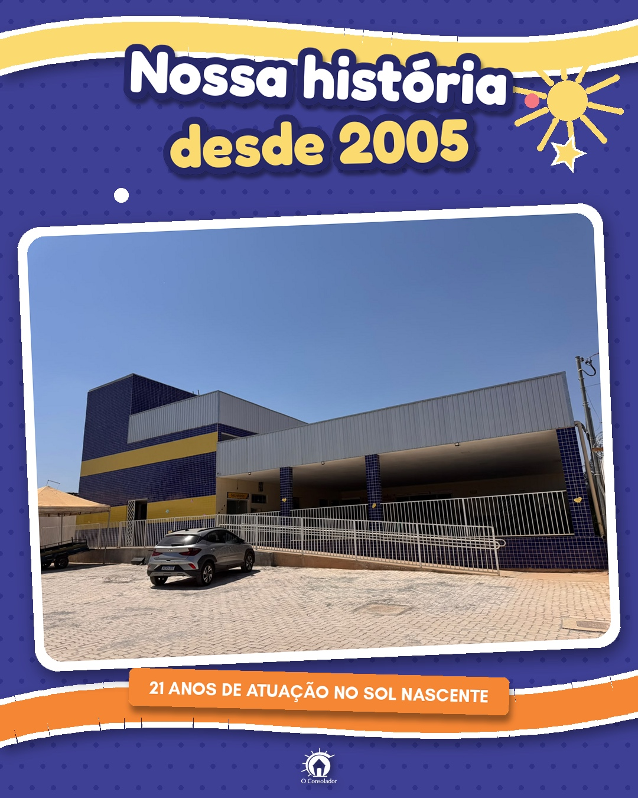 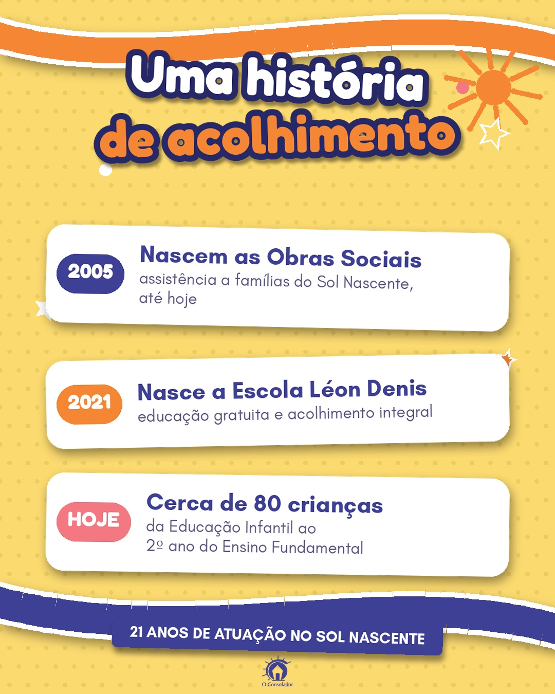

> Desde 2005, acolhendo famílias do Sol Nascente. 🏡  
> Foram 21 anos de assistência social e, desde 2021, a Escola Espírita Léon Denis oferece educação gratuita e acolhimento integral para as crianças da comunidade. Hoje a escola atende cerca de 80 crianças, da Educação Infantil até o 2º ano do Ensino Fundamental.  
> Faça parte dessa história. Link na bio. 💙  
> #ApadrinheAEducação #OConsolador #NossaHistória  

---

## 04/11 (quarta) · Carrossel · 3 slides

**✅ Publicado** · [ver no Instagram](https://www.instagram.com/p/DfV1Eb3kcuE/)

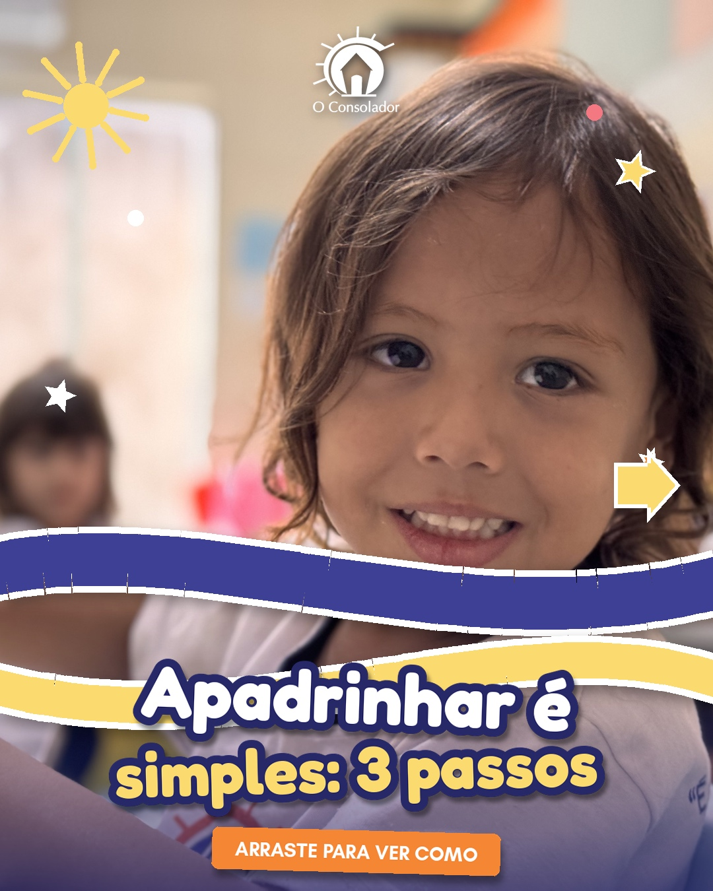 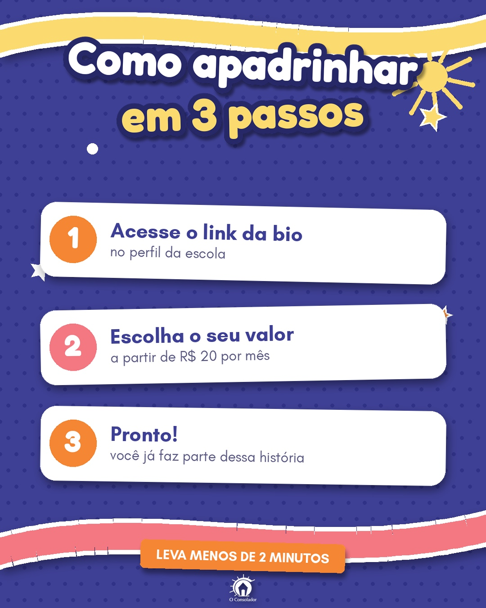 

> Apadrinhar é simples e leva menos de 2 minutos. 💛  
>
> 1️⃣ Acesse o link da bio  
> 2️⃣ Escolha o seu valor, a partir de R$ 20 por mês  
> 3️⃣ Pronto! Você já faz parte dessa história.  
>
> Seu apadrinhamento ajuda a manter a Escola Espírita Léon Denis gratuita para crianças do Sol Nascente.  
>
> 👉 Link na bio. Seja padrinho ou madrinha!  
>
> #ApadrinheAEducação #EscolaLéonDenis #OConsolador #SolNascente #EducaçãoTransforma  

---

## 06/11 (sexta) · Carrossel · 2 slides

**✅ Publicado** · [ver no Instagram](https://www.instagram.com/p/Dfa6IqPiQk_/)

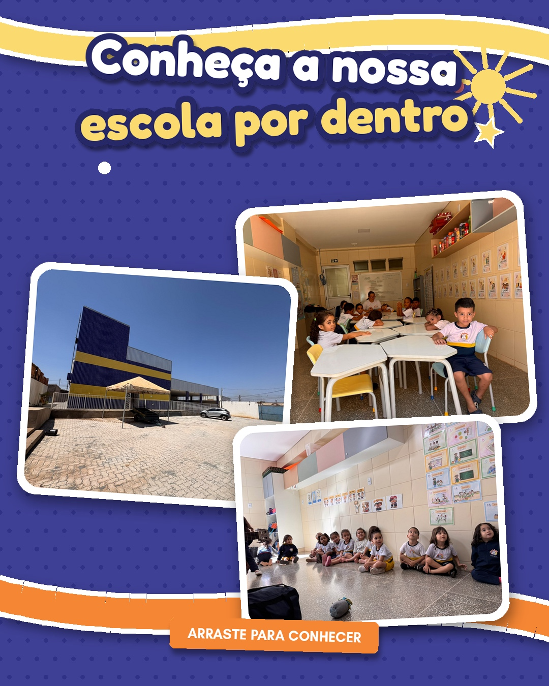 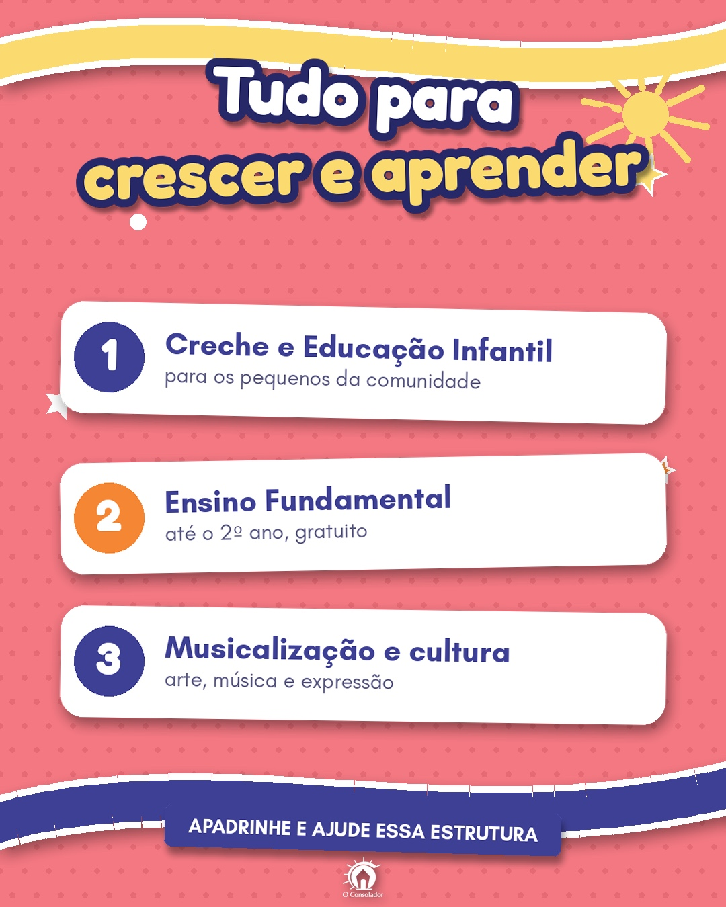

> Venha conhecer a nossa escola por dentro! 🏫  
> Salas, parquinho, musicalização: tudo pensado para as crianças crescerem e aprenderem com carinho.  
> 👉 Apadrinhe e ajude a manter essa estrutura. Link na bio.  
> #ApadrinheAEducação #OConsolador #EscolaLéonDenis  

---

## 09/11 (segunda) · Carrossel · 2 slides

**🗓️ Agendado**

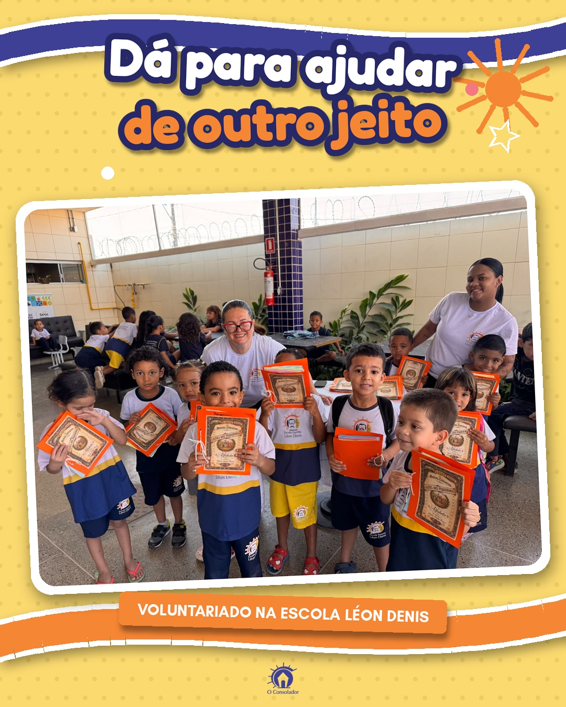 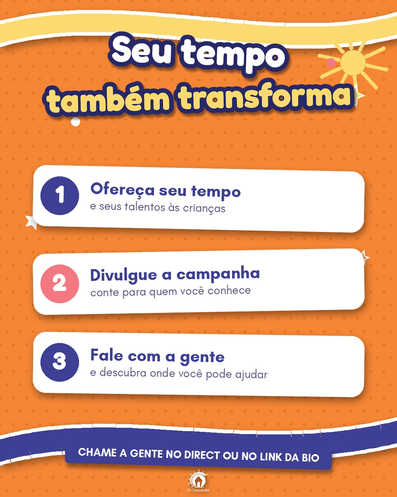

> Dá para ajudar de outro jeito! 🌟  
>
> Seu tempo e seus talentos também transformam:  
> ✨ Ofereça seu tempo às crianças  
> ✨ Divulgue a campanha para quem você conhece  
> ✨ Fale com a gente e descubra onde pode ajudar  
>
> Chame no direct ou acesse o link da bio.  
>
> #Voluntariado #ApadrinheAEducação #OConsolador #EscolaLéonDenis  

---

## 10/11 (terça) · Carrossel · 2 slides

**🗓️ Agendado**

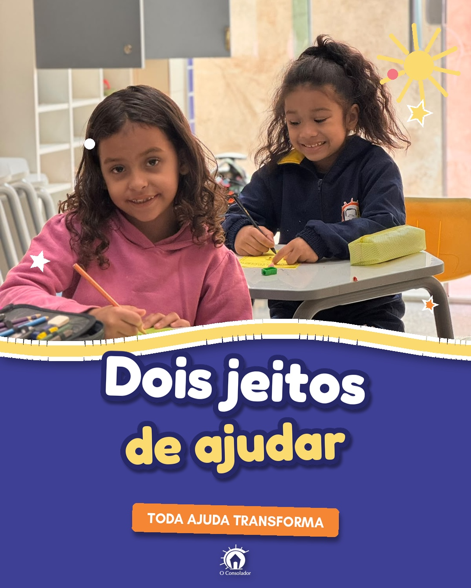 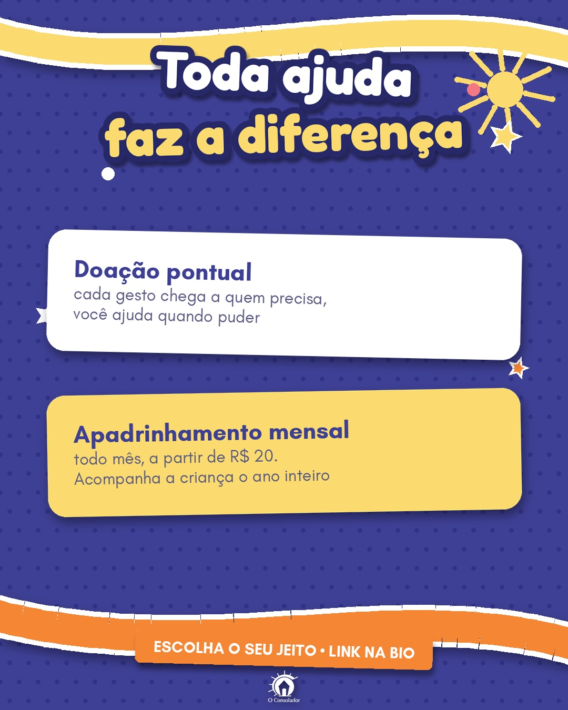

> Toda ajuda faz a diferença. 💛  
> Você pode ajudar com uma doação pontual, quando puder, ou apadrinhando todo mês, a partir de R$ 20. O apadrinhamento acompanha a criança o ano inteiro e ajuda a escola a se organizar com tranquilidade.  
> Escolha o seu jeito de ajudar. Link na bio. 🧡  
> #ApadrinheAEducação #OConsolador #TodaAjudaConta  

---

## 11/11 (quarta) · Carrossel · 2 slides

**🗓️ Agendado**

 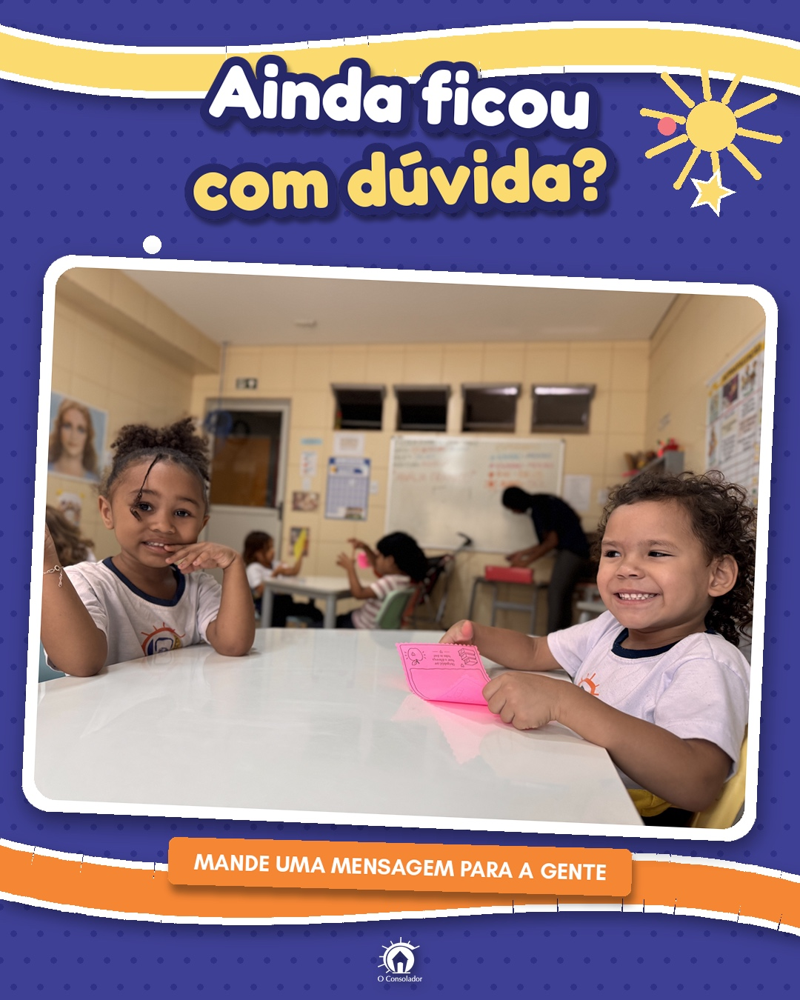

> Perguntas frequentes sobre o Apadrinhe a Educação 💬  
>
> ❓ Quanto custa? A partir de R$ 20 por mês.  
> ❓ Para onde vai o dinheiro? Professores, alimentação, material e estrutura.  
> ❓ A escola é gratuita? Sim, para todas as crianças.  
>
> Ficou com dúvida? Mande uma mensagem ou apadrinhe pelo link da bio.  
>
> #ApadrinheAEducação #EscolaLéonDenis #OConsolador  

---

## 13/11 (sexta) · Post único

**🗓️ Agendado**

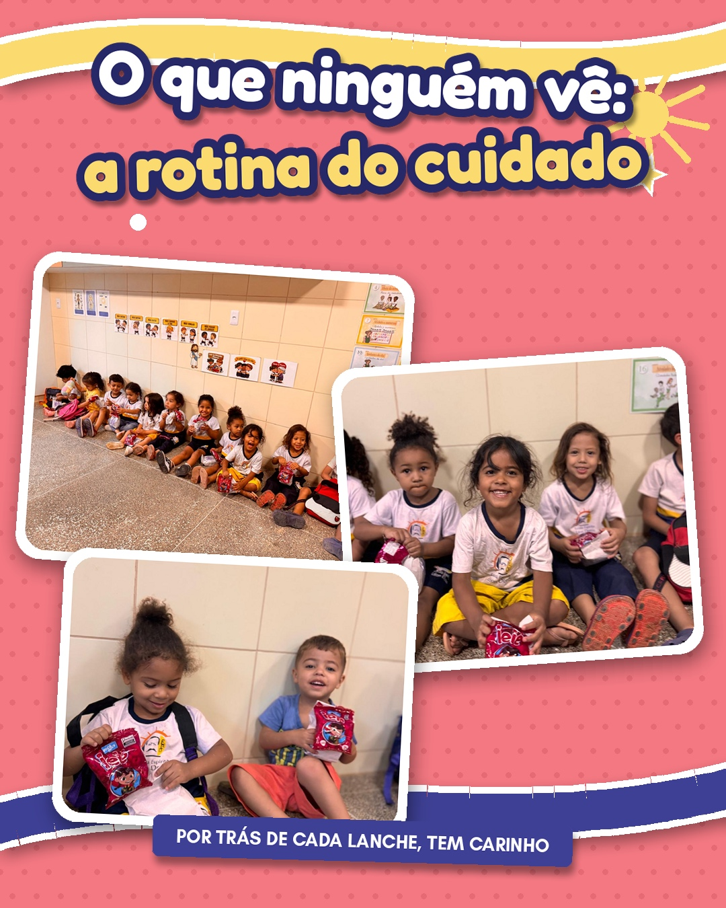

> O que ninguém vê: a rotina do cuidado. 🧡  
>
> Por trás de cada lanche, de cada fila organizada e de cada sorriso, tem uma equipe cuidando com carinho de cada criança.  
>
> Apadrinhar ajuda a manter essa rotina todos os dias. Link na bio.  
>
> #ApadrinheAEducação #OConsolador #EscolaLéonDenis #SolNascente  

---

## 16/11 (segunda) · Post único

**🗓️ Agendado**

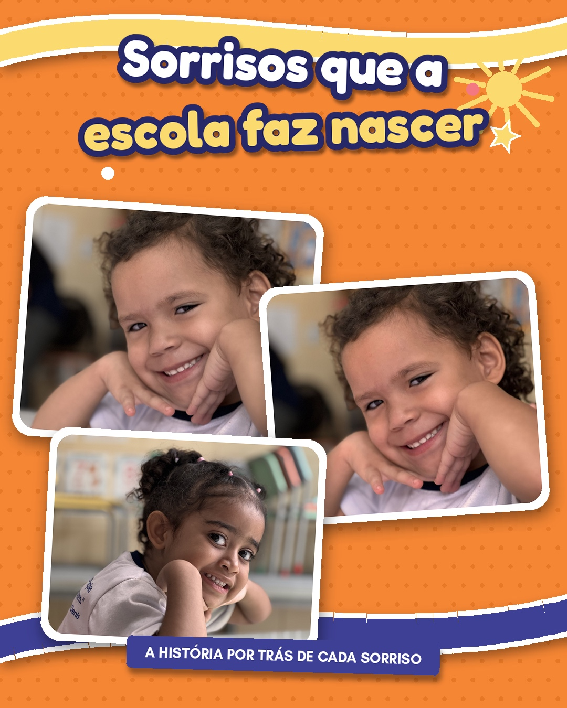

> Cada sorriso aqui tem uma história. 😊💛  
> Na Escola Espírita Léon Denis, as crianças do Sol Nascente encontram acolhimento, aprendizado e carinho todos os dias.  
> Você pode ajudar a manter esses sorrisos. Apadrinhe a partir de R$ 20/mês. Link na bio.  
> #ApadrinheAEducação #OConsolador #EscolaLéonDenis #SolNascente  

---

## 18/11 (quarta) · Carrossel · 2 slides

**🗓️ Agendado**

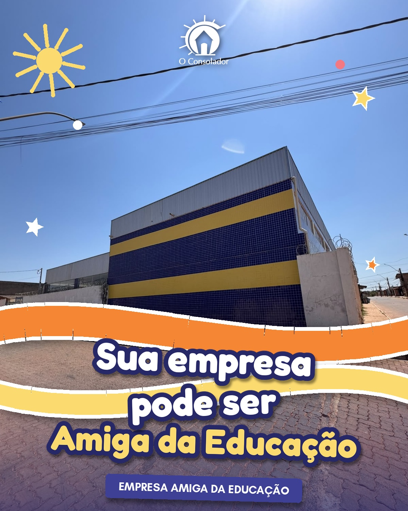 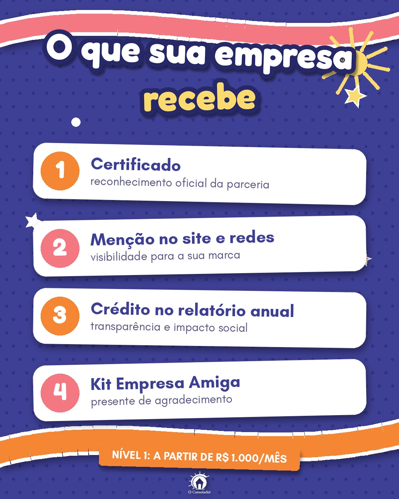

> Sua empresa pode ser Amiga da Educação! 🏢💛  
>
> Nível 1, a partir de R$ 1.000/mês:  
> ✅ Certificado  
> ✅ Menção no site e redes  
> ✅ Crédito no relatório anual  
> ✅ Kit Empresa Amiga  
>
> Fale com a gente pelo direct ou pelo link da bio.  
>
> #EmpresaAmigaDaEducação #ResponsabilidadeSocial #OConsolador #EscolaLéonDenis  

---

## 20/11 (sexta) · Carrossel · 2 slides

**🗓️ Agendado**

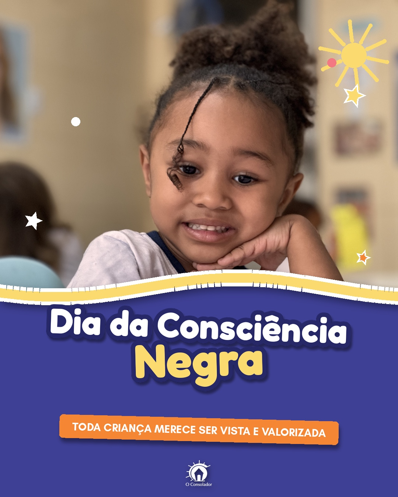 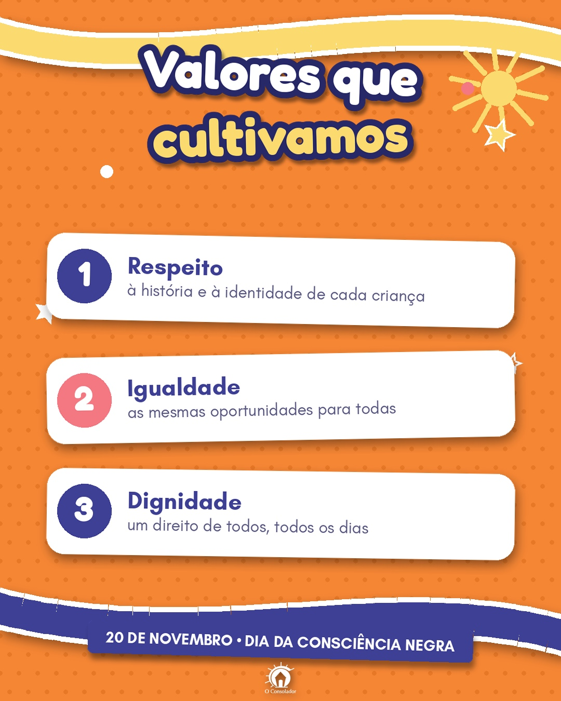

> Hoje é Dia da Consciência Negra. ✊🏾  
> Na Escola Espírita Léon Denis, acreditamos que toda criança merece ser vista, respeitada e valorizada, com a sua história e a sua identidade.  
> Respeito, igualdade e dignidade: valores que a gente cultiva todos os dias, junto com as famílias do Sol Nascente.  
> #ConsciênciaNegra #20DeNovembro #EscolaLéonDenis #OConsolador  

---

## 23/11 (segunda) · Post único

**🗓️ Agendado**

> A Black Friday está chegando. E se, em vez de encher o carrinho, você apadrinhasse? 🛒➡️💛  
> A partir de R$ 20/mês você ajuda a manter a Escola Espírita Léon Denis gratuita para as crianças do Sol Nascente.  
> 👉 Link na bio.  
> #BlackFridayDoBem #ApadrinheAEducação #OConsolador  

---

## 25/11 (quarta) · Post único

**🗓️ Agendado**

> Faltam 2 dias para a Black Friday do Bem! 🖤🧡  
> Em vez de comprar, apadrinhe. Aguarde: dia 27 tem novidade por aqui.  
> #BlackFridayDoBem #ApadrinheAEducação #OConsolador  

---

## 27/11 (sexta) · Post único

**🗓️ Agendado**

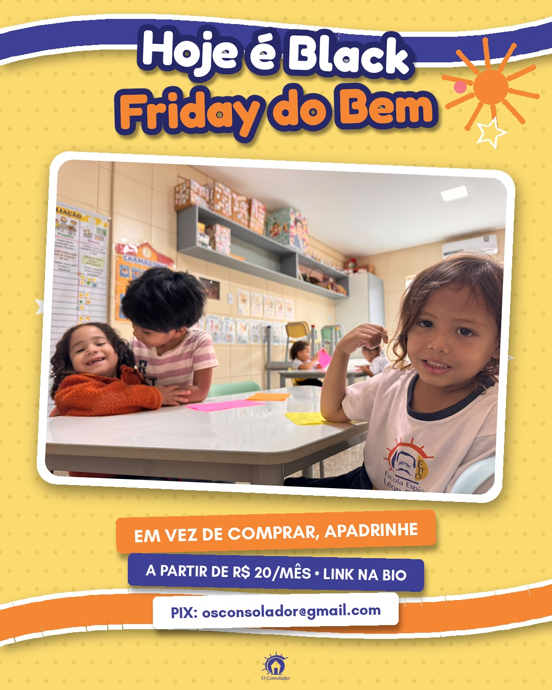

> HOJE é Black Friday do Bem! 🖤🧡  
> Em vez de comprar, apadrinhe. A partir de R$ 20/mês você ajuda a manter a Escola Espírita Léon Denis gratuita.  
> 👉 Link na bio  
> 💳 PIX: osconsolador@gmail.com (doação destinada às Obras Sociais O Consolador, mantenedora da Escola)  
> #BlackFridayDoBem #ApadrinheAEducação #OConsolador  

---

## 30/11 (segunda) · Post único

**🗓️ Agendado**

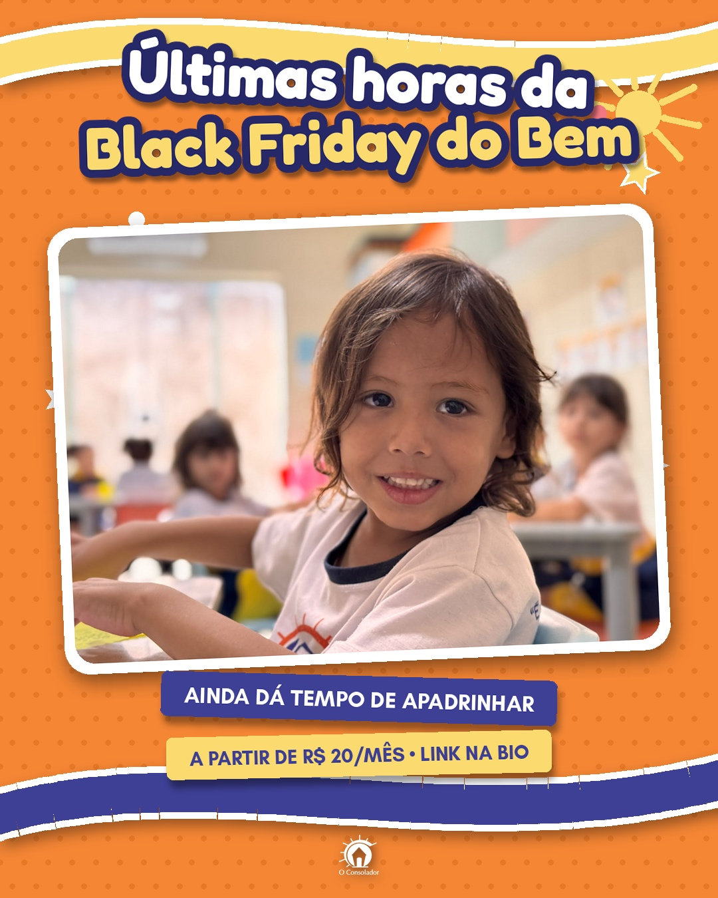

> Últimas horas da Black Friday do Bem! ⏰🖤  
> Ainda dá tempo de apadrinhar: a partir de R$ 20/mês, link na bio.  
> #BlackFridayDoBem #ApadrinheAEducação #OConsolador  

---

## 23/12 (quarta) · Carrossel · 3 slides

**🗓️ Agendado**

  

> R$ 750. Esse é o custo real de manter uma criança na escola por mês. 🧡  
> Na segunda imagem mostramos a conta: R$ 60.000 de custo mensal ÷ 80 crianças atendidas.  
> Ninguém precisa cobrir tudo sozinho. Todo apoio conta, a partir de R$ 20/mês.  
> 👉 Link na bio para apadrinhar.  
> #ApadrinheAEducação #OConsolador #TransparênciaImporta  

---
